# OpenUnit - 700 MW Gas-Fired Steam Power Plant Simulator

A full-scope training simulator of a 700 MW subcritical drum-type steam unit fired with natural gas:
a dynamic process model, 8 independent controllers exchanging data over Modbus TCP (in Node.js or
OpenPLC soft-PLCs) and a high-performance web HMI with an instructor station.

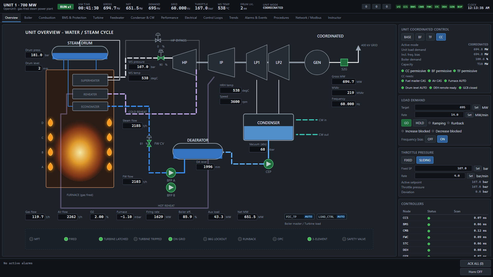

## Screenshots

| | |
|---|---|
| **Boiler**<br>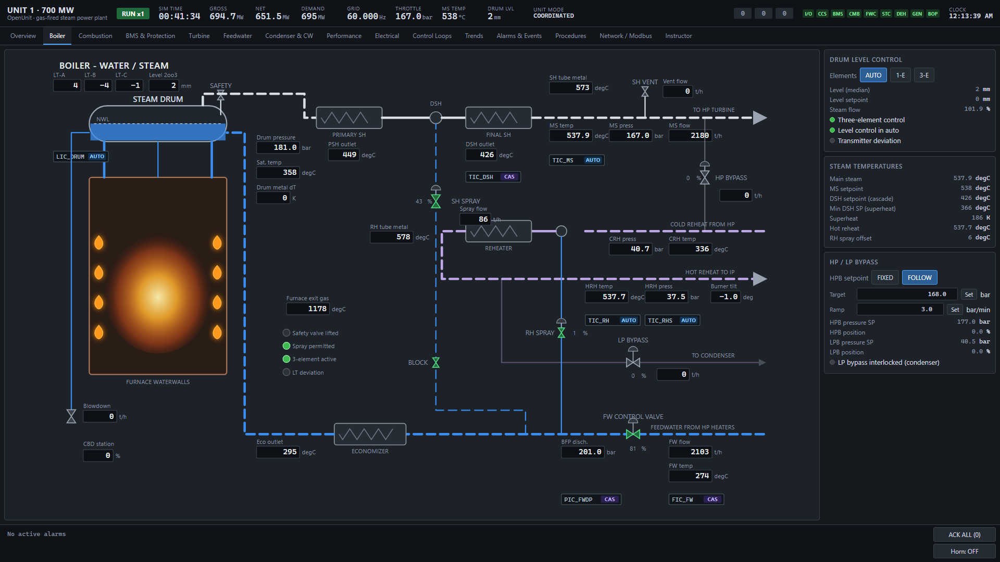 | **Combustion**<br>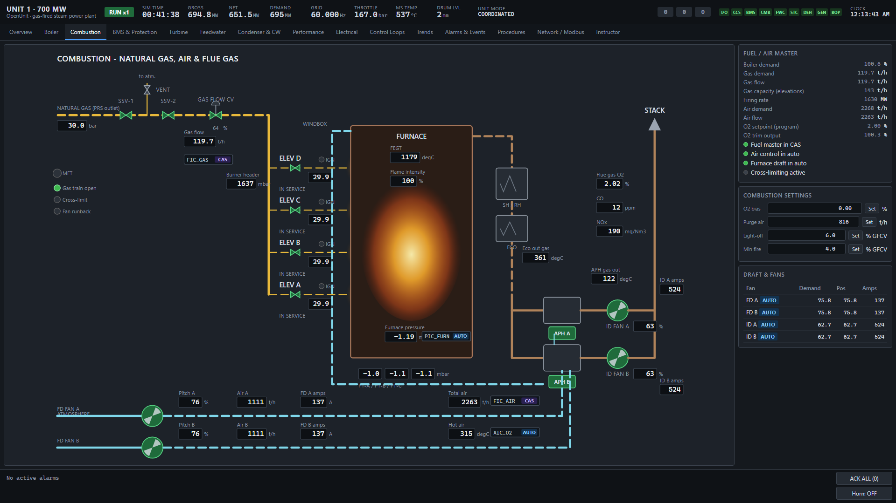 |
| **BMS & Protection**<br>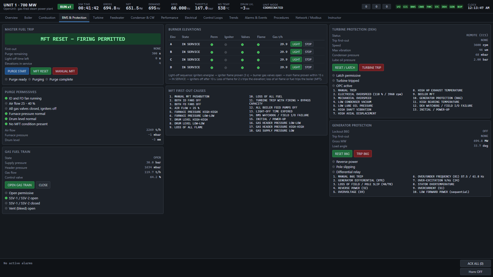 | **Turbine**<br>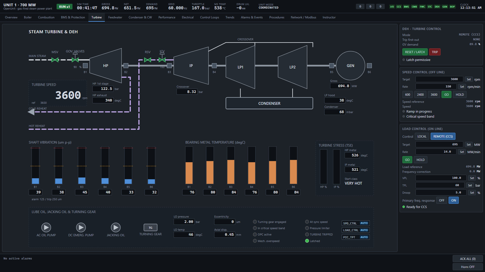 |
| **Feedwater**<br>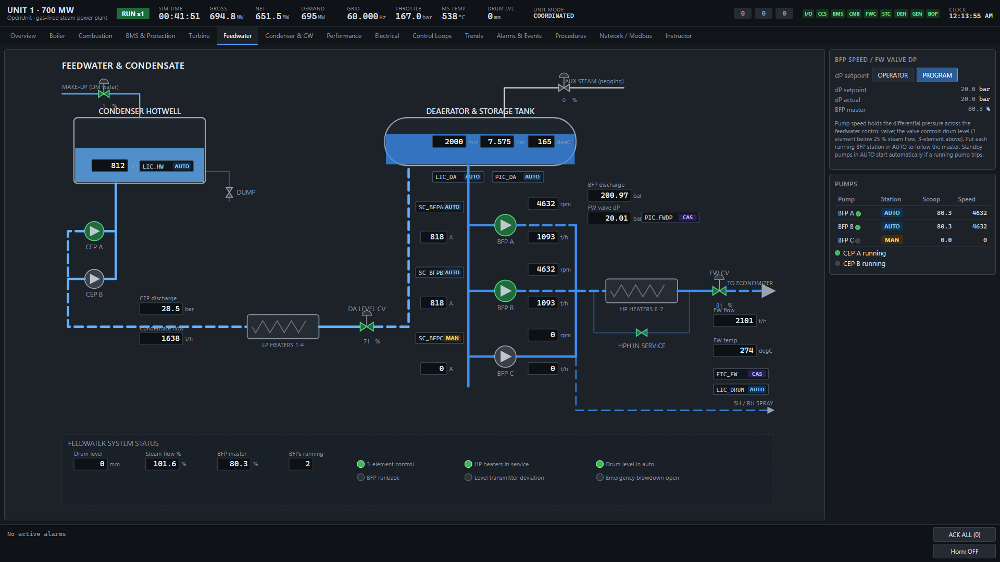 | **Condenser & CW**<br>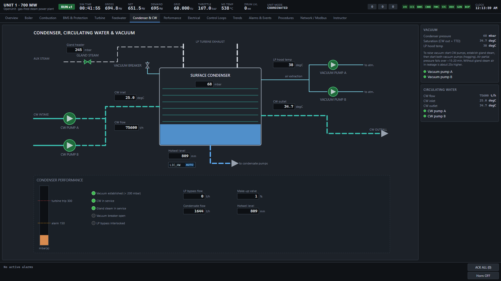 |
| **Performance**<br>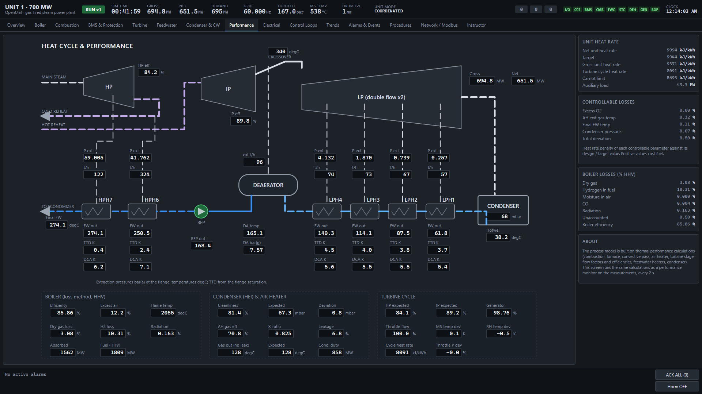 | **Electrical**<br>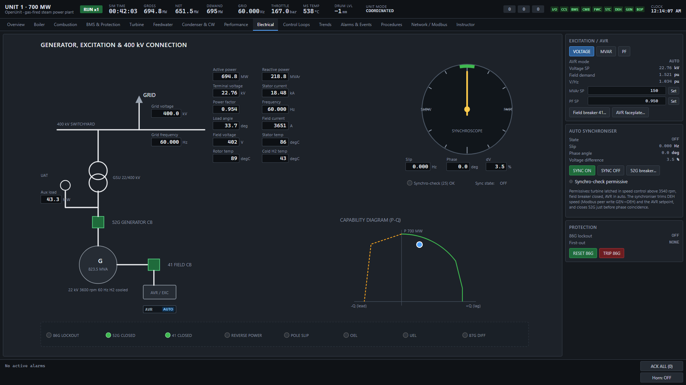 |
| **Control Loops**<br>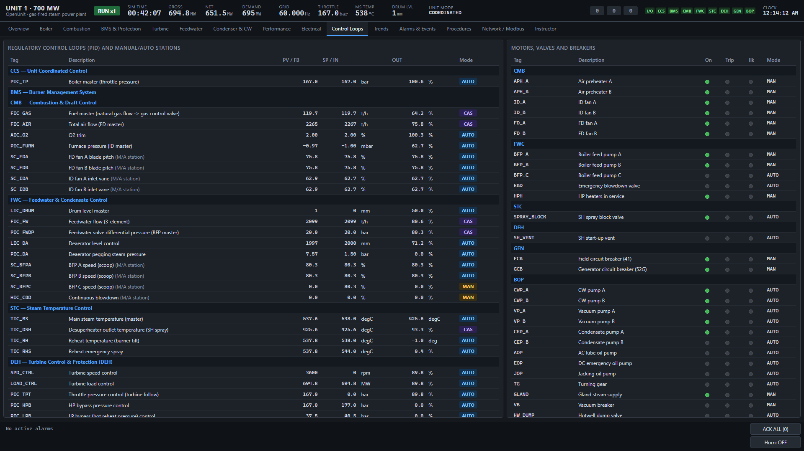 | **Trends**<br>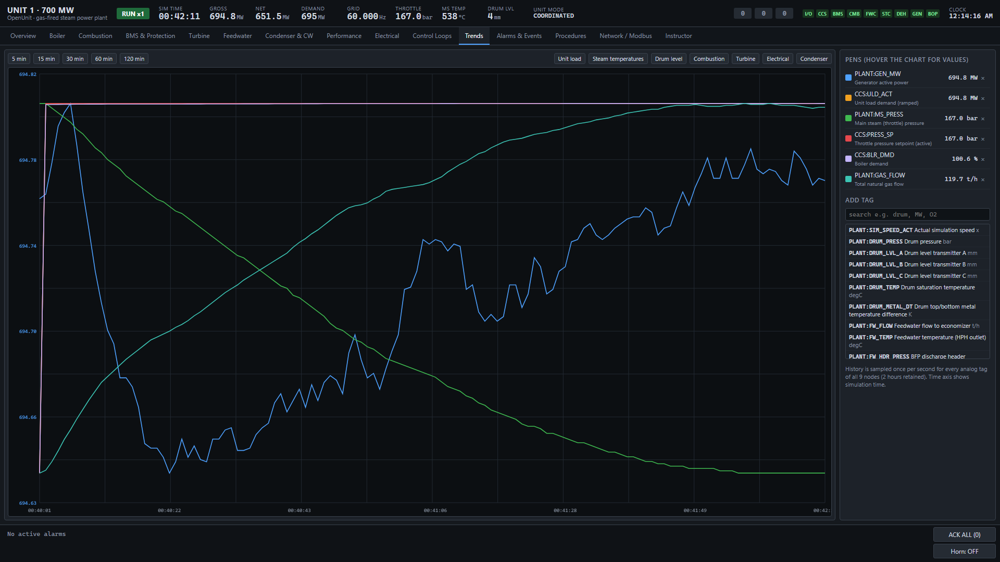 |
| **Alarms & Events**<br>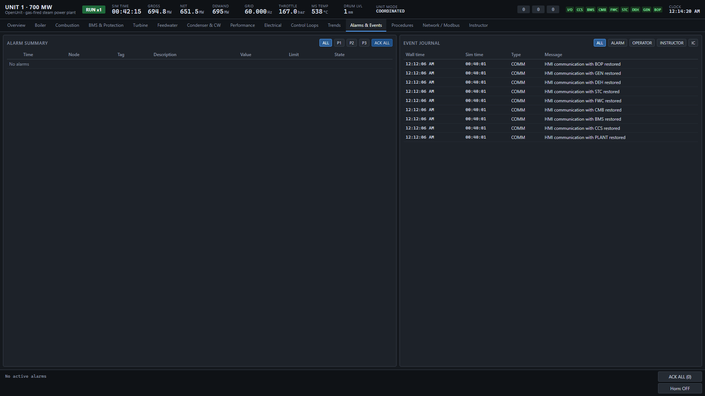 | **Procedures**<br>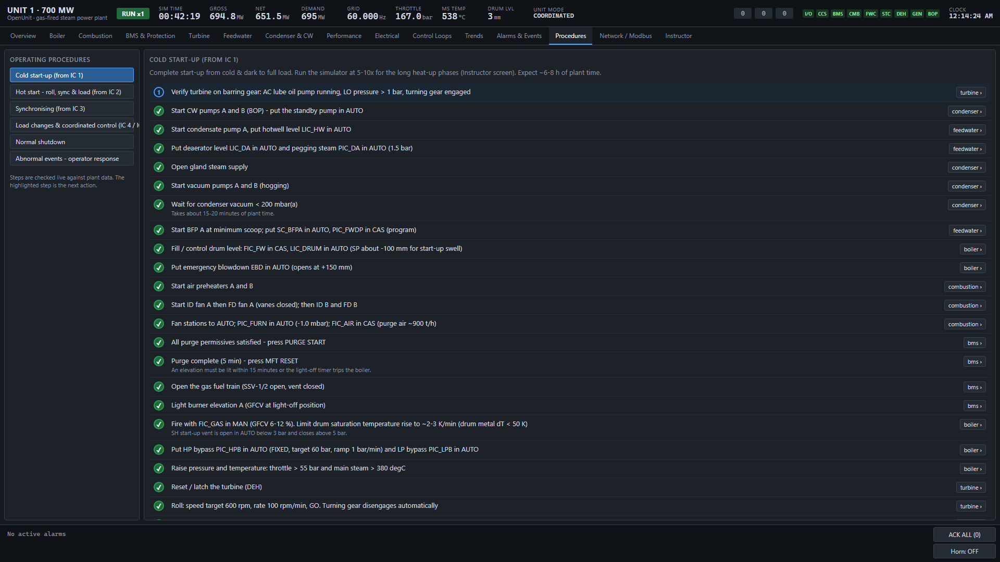 |
| **Network / Modbus**<br>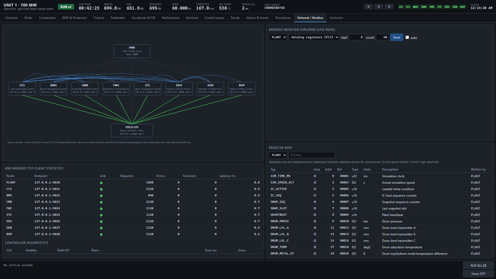 | **Instructor**<br>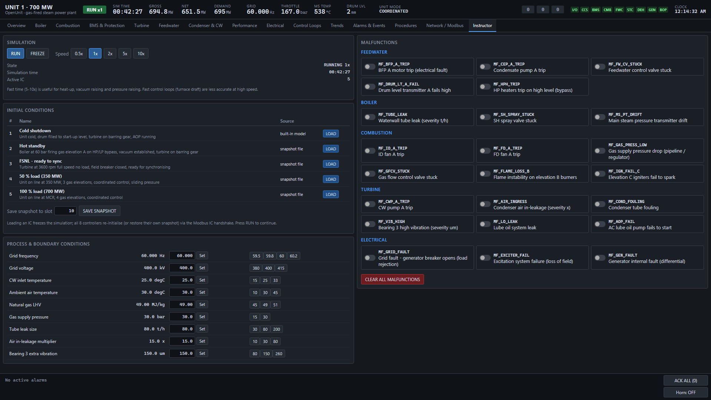 |

## Installation

**Requirements:** [Node.js](https://nodejs.org/) 20 or later. For the optional OpenPLC soft-PLC
mode on Windows: WSL 2 and OpenPLC Editor (the installer checks and offers to install them).

### Windows

1. Clone or download this repository.
2. Double-click **`OpenUnit.cmd`** in the project folder.
3. Choose **12 Install / repair** for the one-time setup (or run `OpenUnit.cmd install`).
4. Choose **1** (OpenPLC soft-PLCs) or **2** (Node.js controllers) to start the simulator.
   The HMI opens in your browser.

### Any platform (Node.js controllers)

```bash
git clone https://github.com/alialaqoul/OpenUnit.git
cd OpenUnit
npm install
npm start
```

Then open **http://127.0.0.1:8080**. The unit starts at full load and runs as soon as all
controllers are on line.

## License

MIT
